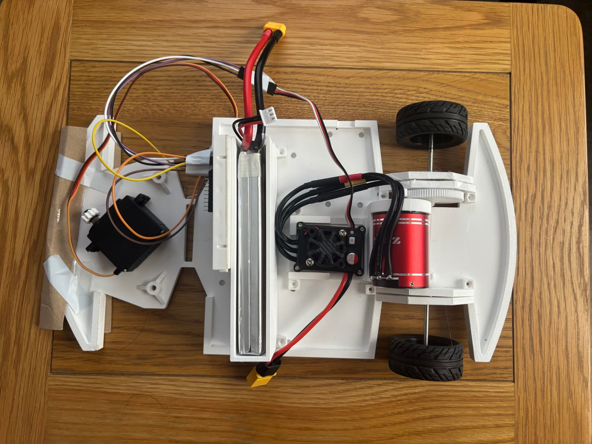
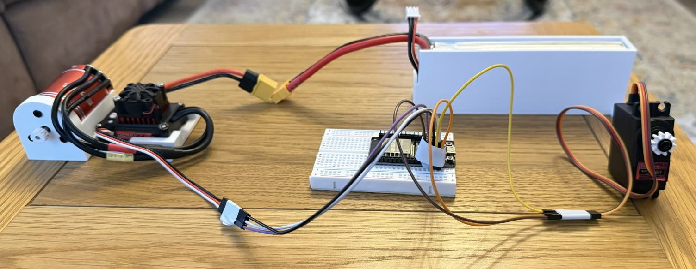

# ESP32 RC Car
Firmware for an ESP32-based RC car driven by a PS4 controller over Bluetooth.

## Overview
A personal summer project where I built the electronics for an RC car around an ESP32. The ESP32 pairs directly with a PS4 controller, so no transmitter, receiver or phone app is needed. It converts the controller's stick and trigger inputs into standard 50 Hz RC PWM signals for the steering servo and the car's ESC.

## Features
- **PS4 controller over Bluetooth**: the controller pairs straight to the ESP32 using Bluepad32. No separate RC transmitter or receiver.
- **Proportional steering**: the left stick X axis maps to the full 1000–2000 µs servo range, with a deadzone so the wheels stay centred when the stick is at rest.
- **Trigger throttle**: R2 drives forward and L2 reverses, both proportionally.
- **Kill switch**: holding Cross (✕) forces the throttle to neutral right away.
- **Fail-safe outputs**: on startup, on disconnect, with no controller, or with both triggers pressed at once, the car outputs neutral throttle and centred steering.
- **Safe ESC arming**: sends a steady 1500 µs neutral pulse for 3 seconds at boot so the ESC arms before any throttle command can reach it.
- **Live telemetry**: steering pulse, trigger values and ESC pulse are printed to the Serial Monitor every loop.

## Hardware
- ESP32 DevKit (original ESP32: the PS4 controller needs Bluetooth Classic, which the C3/C6/S3 don't have)
- Brushless motor and brushless ESC (with cooling fan)
- 7.4 V LiPo battery pack (XT60 connectors)
- Metal-gear steering servo
- 3D-printed chassis
- PS4 DualShock 4 controller

*The car from above: steering servo (left), LiPo pack (centre), and ESC and brushless motor driving the rear axle (right). Only the rear wheels were fitted for this photo.*

*Bench test of the circuit: ESP32 on a breadboard driving the ESC and brushless motor (left) and the steering servo (right), with the LiPo pack at the back.*

## How it Works
The firmware is written in the Arduino IDE using the [Bluepad32](https://github.com/ricardoquesada/bluepad32) and [ESP32Servo](https://github.com/madhephaestus/ESP32Servo) libraries.

Every 20 ms (50 Hz, the standard RC frame rate) the main loop reads the controller:

| Input | Range | Output |
|---|---|---|
| Left stick X | −512 … 512 | Servo 1000 µs (left) … 1500 µs (centre) … 2000 µs (right) |
| R2 | 0 … 1023 | ESC 1500 µs (neutral) … 2000 µs (full forward) |
| L2 | 0 … 1023 | ESC 1500 µs (neutral) … 1000 µs (full reverse) |
| Cross (✕) | held | ESC forced to 1500 µs |

The stick and triggers have small deadzones (30 and 20) to filter out drift, and every throttle value is clamped to the 1000–2000 µs range before it reaches the ESC.

## Wiring
| Connection | ESP32 GPIO |
|---|---|
| Steering servo signal | 12 |
| ESC signal | 13 |
| Servo / ESC ground | GND (common ground with the ESP32) |

The ESC and brushless motor are powered by a 7.4 V LiPo battery, and the ESC's Battery Eliminator Circuit (BEC) was used to step down the voltage to power the ESP32 and the servo.
The servo, ESC and ESP32 must share a common ground.

## Getting Started
1. **Install the board package**: in the Arduino IDE go to File → Preferences → *Additional Boards Manager URLs* and add
   `https://raw.githubusercontent.com/ricardoquesada/esp32-arduino-lib-builder/master/bluepad32_files/package_esp32_bluepad32_index.json`.
   Then go to Boards Manager, install **esp32_bluepad32**, and select your ESP32 board from the *esp32_bluepad32* section.
2. **Add the library**: Library Manager → **ESP32Servo** by Kevin Harrington.
3. **Open the sketch**: [`firmware/esp32_rc_car/esp32_rc_car.ino`](firmware/esp32_rc_car/esp32_rc_car.ino).
4. **Upload** with the wheels off the ground.
5. **Arm the ESC**: open the Serial Monitor at 115200 baud. Wait for `ESC should now be armed.` and then `Waiting for PS4 controller...`.
6. **Pair the controller**: hold **Share + PS** until the light bar flashes quickly. The Serial Monitor shows `Controller connected!` once it's paired.

> To clear old pairings, uncomment `BP32.forgetBluetoothKeys();` in `setup()`, upload once, then comment it out again.

## Controls
| Control | Action |
|---|---|
| Left stick (left/right) | Steer |
| R2 | Forward (proportional) |
| L2 | Reverse (proportional) |
| Cross (✕) | Kill switch: throttle to neutral |

## Key Challenges
The main challenge was getting the ESC to arm reliably. The ESC only arms once it sees a steady neutral signal at the right frequency, so the servo and ESC outputs are both locked to 50 Hz, and the firmware holds a 1500 µs neutral pulse for 3 seconds at boot before it accepts any controller input. The same neutral value is sent whenever the controller isn't connected, so the ESC stays armed and the car can't creep.

The other challenge was powering the ESP32 and the servo. I ultimately went from a more complicated design using a buck converter to a less complicated one using the BEC to power the ESP32 and the servo.

## Licence
MIT. See [LICENSE](LICENSE).
